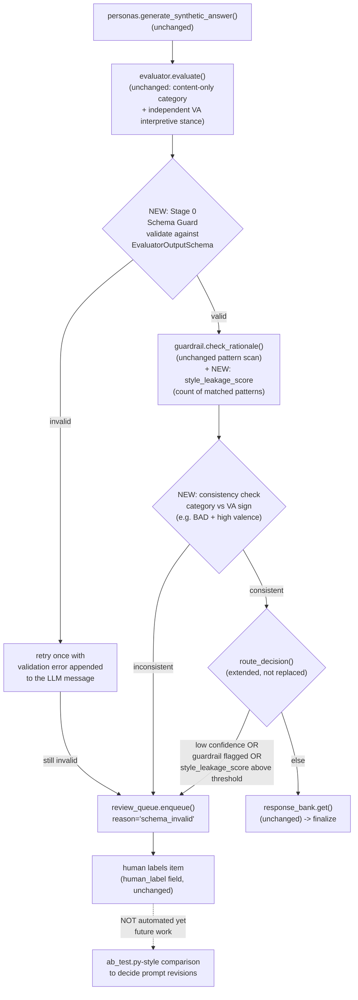

# Unified Architecture: Conversation Engine v1 + Academic LLM-as-Judge/VA Pipeline

**Baseline used as "existing architecture":** the actual Conversation Engine
v1 codebase in this repo (`personas.py`, `evaluator.py`, `guardrail.py`,
`response_bank.py`, `review_queue.py`, `graph.py`, `ab_test.py`) — not a
separate document. If you meant a different/newer architecture than what's
in this repo, flag it and this doc needs revising.

**Citation note:** three of the four originally-proposed citations
(Zheng et al. 2023, Shi et al. 2024, "PUAudit" 2026) don't actually support
the specific claims they were attached to — see the citation-mismatch table
below and the corrected mapping in Task 3. All four papers are real; the
issue was attribution, not fabrication.

---

## Task 1 — Overlap & Delta Analysis

| Reference stage | Status in this repo | Gap / delta |
|---|---|---|
| **Stage 1: Pre-Processing Guardrails** (schema validation, token bounds, format-hallucination prevention) | Partial. `evaluator.py::_strip_fences()` strips markdown fences, then `json.loads()` — on parse failure raises `ValueError`. `max_tokens` is passed to `llm_client.call_llm()`, bounding *output length* only. | **Gap:** no schema validation on the *parsed* JSON. `data["category"]` is used directly with no check that it's actually one of `config.QUALITY_CATEGORIES` (`GOOD`/`NEUTRAL`/`BAD`); same for `valence`/`arousal` against `config.VALENCE_LEVELS`/`AROUSAL_LEVELS`, and `confidence` against `[0.0, 1.0]`. A malformed-but-parseable response (e.g. `"category": "good"` lowercase, or `confidence: 1.5`) would silently propagate into `Evaluation` and downstream routing. This is the real gap Stage 1 should close — not "hallucination prevention" broadly, but **typed validation of the evaluator's structured output**. |
| **Level 1: Zero-Bias Content Scorer** (decouple content from delivery style) | **Already the core design**, and stronger than the reference implies. `prompts/evaluator_prompt.py`'s `EVALUATOR_SYSTEM_PROMPT_A`/`_B` explicitly instruct content-presence-only scoring ("Do NOT consider or mention: facial expression, eye contact, tone of voice..."). `guardrail.py::check_rationale()` then independently *audits* the evaluator's own rationale text for exactly this kind of leakage, using `config.NO_MASKING_FLAG_PATTERNS`. This is defense-in-depth: prompt-level prevention **and** post-hoc detection, not just one mechanism. | **Gap:** the mechanism is designed but not yet empirically validated — no Cohen's kappa run yet (Week 2, Day 6-7, not started), no bias check across personas yet (Week 2, Day 9). Design ≠ proof. |
| **Stage 2: VA Horizon Mapper** (discrete outcome → continuous V/A coordinates) | **Different mechanism**, not a gap exactly — a real architectural delta worth naming explicitly. The reference implies a *separate, deterministic mapping stage*: category → VA via some fixed function. In this repo, `evaluator.evaluate()` generates category **and** valence/arousal in the **same LLM call**, as an independent "interpretive stance" — by design, explicitly allowed to vary independently of the category (see `EVALUATOR_SYSTEM_PROMPT_A`'s "INTERPRETIVE STANCE" section). | **Delta, not gap:** joint single-call generation is more efficient (one LLM call, not two) but has no cross-check — the LLM could return `category: "BAD"` with `valence: "high"` and nothing catches an internally inconsistent pair. A deterministic mapping stage would guarantee consistency by construction; the current design trades that guarantee for flexibility (the whole point of decoupling emotion from quality per the thesis's No-Masking framing). Worth deciding explicitly whether inconsistent pairs should be *possible* (current) or *flagged* (needs a new check) — see Task 2. |
| **Stage 3: Bias Filter & HITL Calibration** (score divergence, route low-confidence/high-bias to human, refine prompts) | Partial. `graph.py::route_decision()` already routes to `review_queue.enqueue()` when `_is_flagged()` (guardrail matched) OR `_is_low_confidence()` (`confidence < config.CONFIDENCE_ROUTE_THRESHOLD`, currently 0.70) — this matches "route low-confidence or flagged cases to human review." `review_queue.py` stores `reason` (`"low_confidence"` / `"guardrail_flag"` / `"low_confidence+guardrail_flag"`) and a `human_label` field for later labeling. | **Gap 1:** `guardrail.check_rationale()` returns a **binary** `passed: bool` — no continuous divergence/severity score, just pass/fail on any pattern match. **Gap 2:** no automated loop that uses review outcomes to refine system prompts. That currently happens manually — `ab_test.py` (A/B comparing `EVALUATOR_SYSTEM_PROMPT_A` vs `_B`) is the manual analogue of "refine system prompts," not an automated calibration mechanism. |

---

## Task 2 — Unified Architecture



**Component responsibilities (unified):**

1. **Persona Answer Generation** — `personas.generate_synthetic_answer()`. Unchanged.
2. **Content Evaluation + Interpretive VA** — `evaluator.evaluate()`. Unchanged mechanism (single joint call), now feeding into the new schema guard before anything downstream reads it.
3. **Schema Guard (NEW, closes the Stage-1 gap)** — validates the parsed evaluator JSON against a Pydantic model (Task 4) before it's trusted anywhere else. On validation failure: one retry with the validation error appended to the LLM prompt (a "self-healing" retry, standard pattern for structured-output guardrails); on second failure, route straight to `review_queue` with `reason="schema_invalid"` — this is a **new reason value**, additive to the existing `"low_confidence"` / `"guardrail_flag"` / `"low_confidence+guardrail_flag"` set, not a replacement.
4. **No-Masking Guardrail (extended, not rewritten)** — `guardrail.check_rationale()` keeps its existing binary `passed`/`matched_patterns` contract (nothing downstream that depends on it breaks), but the result additionally carries `style_leakage_score = len(matched_patterns)` — a free, already-available magnitude signal, not a new detection mechanism.
5. **Consistency Check (NEW, addresses the Stage-2 delta)** — a small deterministic check: does the VA sign roughly match the category (e.g. `BAD` + `valence="high"` is suspicious)? Not a hard rule — the whole point of decoupling is that mismatches are *allowed* — but a flagged-for-review signal, not a rejection. Keeps the current joint-generation design (cheaper, one LLM call) while adding the traceability the reference's separate-mapping-stage would have given for free.
6. **Bias/Divergence Router (extends `route_decision()`)** — same three inputs as today (confidence, guardrail flag) plus the new `style_leakage_score` compared against a second, lower threshold (e.g. "any match at all" already flags via `passed=False`, so this only matters if you want a `matched_patterns` count of e.g. ≥2 to escalate differently in `review_queue`'s `reason` string — a config decision, not an architecture one).
7. **Response Bank / Review Queue** — unchanged. The Stage-3 "refine system prompts" idea is explicitly **not automated** in this unified design — it stays a human-driven process using `ab_test.py`, flagged in the diagram as future work rather than invented as a fake automated loop.

---

## Task 3 — Academic Grounding Mapping (corrected)

| Component | Citation | What it actually supports |
|---|---|---|
| Schema Guard (Stage 0) | *(no strong peer-reviewed anchor found — see note)* | Structured-output validation for LLM JSON is an active, very recent research area (e.g. arXiv:2604.25359 "The Structured Output Benchmark", arXiv:2605.13076 "TruncProof") but nothing found is peer-reviewed yet. Frame this component as **engineering best practice** (Pydantic/JSON-schema validation is standard practice, not a novel research claim) rather than forcing an academic citation it doesn't need. |
| General awareness that LLM judges carry systematic biases (motivates *why* a bias filter exists at all) | Zheng, L., Chiang, W.-L., Sheng, Y., et al. (2023). *Judging LLM-as-a-Judge with MT-Bench and Chatbot Arena.* NeurIPS 2023. arXiv:2306.05685 | **Correctly scoped use:** this paper validates LLM-as-judge as a methodology and documents judge failure modes including **verbosity bias** — an LLM judge favoring longer/more elaborate answers regardless of quality. That's directly relevant motivation for *why* content/style must be separated (verbosity is a style signal), just not for "schema validation" as originally attached. |
| Content-only scoring for autistic candidates specifically (Level 1) | Whelpley, C. E., & May, C. P. (2023). *Seeing is Disliking: Evidence of Bias Against Individuals with Autism Spectrum Disorder in Traditional Job Interviews.* Journal of Autism and Developmental Disorders. DOI: [10.1007/s10803-022-05432-2](https://doi.org/10.1007/s10803-022-05432-2) | **Strong, direct fit.** Found that NT candidates outperformed ASD candidates when interviewers saw *video*, but ASD candidates did as well or better when evaluators saw only a **transcript** (content only, no delivery cues). This is close to a direct empirical justification for content-only scoring. |
| Content-only scoring, specifically for *algorithmically scored* interviews (Level 1) | Benson, A. L., Colley, K. L., Prasad, J. J., Willis, C. M. G., & Powell-Rudy, T. E. (2025). *Comparing Autistic and Neurotypical Responses to Conventional and Modified Questions in Algorithmically Scored Asynchronous Video Interviews: A Textual Analysis.* International Journal of Selection and Assessment. DOI: [10.1111/ijsa.12512](https://doi.org/10.1111/ijsa.12512) | **Strongest fit of all four replacement/original citations** — this is literally about algorithmic scoring of autistic vs. neurotypical interview responses, the closest match to your actual system in the literature I found. |
| VA Horizon Mapper (Stage 2) | Russell, J. A. (1980). *A circumplex model of affect.* Journal of Personality and Social Psychology, 39(6), 1161-1178. | **Unchanged, correctly used** — this is the actual foundational VA-space paper; no issue with the original citation here. |
| HITL routing / using human input to improve the system (Stage 3) | Li, H., Chu, Y., Yang, K., Copur-Gencturk, Y., & Tang, J. (2025). *LLM-based Automated Grading with Human-in-the-Loop.* arXiv:2504.05239 | **Partial fit, correctly scoped:** GradeHITL has the LLM ask human experts clarifying questions to refine grading *rubrics* — a real precedent for "route uncertain cases to humans, use their input to improve the system." Don't cite it for "divergence scoring" specifically — that mechanism isn't in the paper. |
| Continuous divergence/severity score (part of Stage 3, gap 1 above) | *(no citation forced)* | I didn't find a paper that specifically supports computing a continuous content/style divergence score the way originally described. Rather than attach a loosely-related citation, frame `style_leakage_score` as your own methodological contribution — that's a legitimate and often stronger thing to say in a thesis than an overstretched citation. |

---

## Task 4 — Data Contracts (Pydantic)

These mirror the **existing** dataclasses/dicts exactly where nothing changes, and mark new fields clearly. Nothing here requires changing the return types of `personas.py`, `evaluator.py`, or `guardrail.py` — the Pydantic models below would wrap/validate their existing dict output, not replace the dataclasses those modules already return.

```python
from enum import Enum
from typing import Literal, Optional
from pydantic import BaseModel, Field, model_validator

# --- mirrors config.py's existing enums exactly ---
Category = Literal["GOOD", "NEUTRAL", "BAD"]          # config.QUALITY_CATEGORIES
VALevel = Literal["low", "medium", "high"]              # config.VALENCE_LEVELS / AROUSAL_LEVELS


class EvaluatorOutputSchema(BaseModel):
    """NEW — Stage 0 schema guard. Validates evaluator.py's parsed JSON
    before anything downstream (guardrail, routing) trusts it."""
    category: Category
    valence: VALevel
    arousal: VALevel
    confidence: float = Field(ge=0.0, le=1.0)
    rationale: str = Field(min_length=1)


class GuardrailResultSchema(BaseModel):
    """Mirrors guardrail.py's GuardrailResult exactly, plus one additive
    field. matched_patterns/passed are unchanged in meaning and type —
    existing code reading guardrail_result.as_dict() keeps working."""
    passed: bool
    matched_patterns: list[str] = Field(default_factory=list)
    style_leakage_score: int = 0  # NEW: len(matched_patterns), free to compute

    @model_validator(mode="after")
    def _score_matches_patterns(self) -> "GuardrailResultSchema":
        object.__setattr__(self, "style_leakage_score", len(self.matched_patterns))
        return self


class ConsistencyCheckResult(BaseModel):
    """NEW — addresses the Stage-2 delta (joint category+VA generation
    has no built-in cross-check). Non-blocking: consistent=False routes
    to review, it does not reject the evaluation."""
    consistent: bool
    note: Optional[str] = None  # e.g. "BAD category paired with high valence"


class ReviewQueueItemSchema(BaseModel):
    """Mirrors review_queue.py::enqueue()'s actual record shape exactly —
    queued_at/reason/human_label plus the spread item fields it already
    writes today. reason gains one new allowed value: schema_invalid."""
    queued_at: float
    reason: Literal[
        "low_confidence",
        "guardrail_flag",
        "low_confidence+guardrail_flag",
        "schema_invalid",          # NEW
    ]
    human_label: Optional[Category] = None
    question: str
    persona: str
    answer_text: str
    evaluation: EvaluatorOutputSchema
    guardrail_result: GuardrailResultSchema


class ConversationStateSchema(BaseModel):
    """Validated counterpart to graph.py's ConversationState TypedDict.
    Field names/types match 1:1 so existing graph.py nodes need no
    changes — this is a validation wrapper, not a replacement state."""
    question: str
    persona: str
    answer_text: Optional[str] = None
    evaluation: Optional[EvaluatorOutputSchema] = None
    guardrail_result: Optional[GuardrailResultSchema] = None
    consistency: Optional[ConsistencyCheckResult] = None  # NEW
    final_response: Optional[str] = None
    routed_to: Optional[Literal["review_queue", "finalized"]] = None
```

---

## What this doc does *not* do

This is a design/spec document, not an implementation plan — none of `evaluator.py`, `guardrail.py`, `graph.py`, or `review_queue.py` have been changed to match it. If you want to actually build the Schema Guard, style_leakage_score, or consistency check described in Task 2, that's a separate implementation pass (worth its own plan, since it touches the No-Masking-flagged `guardrail.py`/`config.py` files and should go through the same "flag before editing" process as everything else here).
